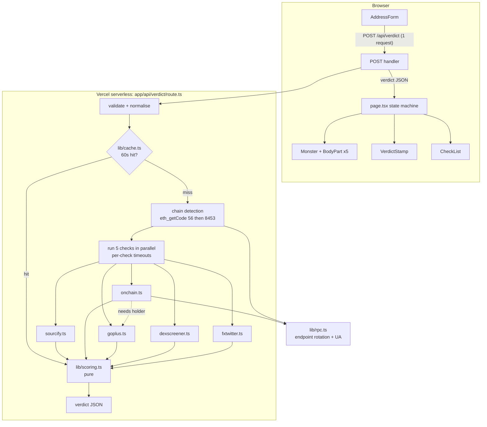

# Design Document

## Overview

Monster Lab is a single Next.js (App Router, TypeScript strict) application deployed on Vercel free tier. One page (`app/page.tsx`) and one API route (`app/api/verdict/route.ts`) live in one repo. The browser sends one `POST /api/verdict`; the route detects the chain, runs five source checks in parallel server-side, scores them with a pure rule-based module, caches the address-level results for 60 seconds, and returns one complete JSON verdict. The client then performs a timed reveal (about 600 ms per part) over that finished verdict. There is no streaming, no database, no environment variable, no API key, and no web3 library.

### Design principles

1. **Failed reads never inflate the verdict.** Any error, timeout, or unexpected shape becomes `unknown` (grey). `unknown` earns 0 points but keeps its weight in the denominator.
2. **Only `lib/sources/*` and `lib/rpc.ts` perform I/O.** `lib/scoring.ts` is pure.
3. **Plain language with evidence.** Every finding is one jargon-free sentence plus an evidence link.
4. **Verified facts only.** Source behaviours below come from the steering files and were verified 12 Nov 2026. Anything unverified is coded defensively and flagged.

## Architecture



### File layout (matches `structure.md`)

```
app/layout.tsx, app/page.tsx, app/globals.css, app/api/verdict/route.ts
lib/sources/{sourcify,onchain,goplus,dexscreener,fxtwitter}.ts
lib/{scoring,rpc,cache}.ts
lib/types.ts        # shared types only (no I/O)
lib/constants.ts    # UPPER_SNAKE_CASE constants: endpoints, UA, selectors, timeouts, weights
components/{Monster,BodyPart,VerdictStamp,CheckList,AddressForm}.tsx
```

`lib/types.ts` and `lib/constants.ts` are small shared-type and constant modules added to avoid duplicating shapes between server and client; they hold no logic and perform no I/O. Everything else matches the steering file tree.

### Research facts that constrain the design

| Source | Constraint (verified 12 Nov 2026) | Design consequence |
|---|---|---|
| Sourcify | API v2 only: `GET https://sourcify.dev/server/v2/contract/{chainId}/{address}`. v1 is REMOVED (`/check-by-addresses` → 404 "API v1 is removed"). 200 + non-null `match` (`"match"` or `"exact_match"`) = verified; 404 + `match: null` = unverified. | Status mapping in `sourcify.ts` exactly as in the table below. Any other status → one retry → `unknown`. No Etherscan/BscScan (they need keys). |
| GoPlus | `GET https://api.gopluslabs.io/api/v1/token_security/{chainId}?contract_addresses={address}`. Envelope `{"code":1,"message":"OK","result":{...}}` keyed by the LOWERCASED address. All values are strings; flags `"0"`/`"1"`. | Parse with a string-flag helper. Never code against `owner_address`, `cannot_sell_all`, `dex`. |
| GoPlus tax | Tax = `buy_tax`/`sell_tax`. A plain `eth_call` of `transfer` returns only a boolean. | Tax is never "measured"; findings cite GoPlus. Balance-delta tax simulation is a v2 idea and is not built. |
| GoPlus `is_open_source` | Corroborates Sourcify, never replaces it. | Mentioned in HEAD finding text only; cannot change HEAD state. |
| GoPlus `holders[]` | Supplies the `from` address for the transfer simulation. | HEART depends on the GoPlus promise for its `from`. |
| EIP-1967 slot | `0x360894a1…2bbc` via `eth_getStorageAt`. Base USDC reads ZERO yet is a proxy (non-1967 layout). | GoPlus `is_proxy` is the PRIMARY proxy signal; slot read is corroboration only, never the sole test. |
| Transfer simulation | `eth_call` `from` = top holder, `to` = token, `data` = `0xa9059cbb` + dead address + small amount. `0x…01` success; revert = honeypot signal. One vote, not proof of safety. | HEART copy says "one signal, not proof". |
| BSC RPC | `bsc-dataseed2/3/4.bnbchain.org`, fallback `bsc.publicnode.com`. Browser UA REQUIRED (UA-less rejected). `bsc-dataseed1` is BANNED (403s after sustained polling). | Endpoint list excludes dataseed1; `rpc.ts` asserts no URL contains `bsc-dataseed1`; rotation and low request volume. |
| Base RPC | `https://base-rpc.publicnode.com`, no special UA. | Single endpoint, one retry. |
| DexScreener | `GET https://api.dexscreener.com/token-pairs/v1/{chainSlug}/{tokenAddress}`, slugs `bsc`/`base`, returns a JSON ARRAY. Top pair by `liquidity.usd`. Empty-pair shape NOT observed. | Non-array or empty = no market, coded defensively. <$5k = thin. |
| fxtwitter | `GET https://api.fxtwitter.com/{username}` ONLY, real browser UA, up to 3 retries (transient bodies without `user`). HTTP 302 → github.com/FxEmbed/FxEmbed = handle does not exist. `api.vxtwitter.com` has served fabricated data — NEVER used. | `redirect: "manual"`; 302 → `rotten`; all attempts failed → `unknown`. |
| Rate limits | UNVERIFIED for every source. | Low request volume, 60s cache, no polling. |

## Data models

All types live in `lib/types.ts`.

```ts
export type CheckState = "healthy" | "rotten" | "unknown";
export type PartId = "head" | "heart" | "leftArm" | "rightArm" | "legs";
export type VetoCode = "HONEYPOT" | "TRANSFER_REVERT" | "NO_CODE";
export type ScoreBand = "corpse" | "twitching" | "alive" | "thriving";
export type ChainId = 56 | 8453;

/** Common result shape returned by every lib/sources/check<Source> function. */
export interface CheckResult<D = unknown> {
  state: CheckState;
  finding: string;          // one plain-language sentence
  evidenceUrl?: string;
  data?: D;                 // source-specific parsed fields (server-side use)
  veto?: VetoCode;          // set only by HEART (TRANSFER_REVERT) and LEFT ARM (HONEYPOT)
  notProvided?: boolean;    // LEGS only: no handle supplied
}

export interface ChainInfo { id: ChainId; name: "BNB Chain" | "Base"; slug: "bsc" | "base"; explorerUrl: string; }
```

### POST /api/verdict

**Request** (`Content-Type: application/json`):

```json
{ "address": "0xbb4CdB9CBd36B01bD1cBaEBF2De08d9173bc095c", "chain": 56, "xHandle": "@example" }
```

- `address` required, `^0x[0-9a-fA-F]{40}$`.
- `chain` optional, `56` or `8453`. The UI never sends it; it exists for deterministic testing. If present, only that chain is probed.
- `xHandle` optional, leading `@` stripped, `^[A-Za-z0-9_]{1,15}$`.

**Success response** (HTTP 200):

```ts
export interface PartResult {
  part: PartId;
  label: "HEAD" | "HEART" | "LEFT ARM" | "RIGHT ARM" | "LEGS";
  source: "Sourcify" | "On-chain" | "GoPlus" | "DexScreener" | "fxtwitter";
  state: CheckState;
  finding: string;
  evidenceUrl?: string;
  notProvided?: boolean;
  points: number;           // earned
  maxPoints: number;        // weight (0 for not-provided LEGS in the denominator)
}

export interface VerdictResponse {
  address: string;                       // lowercased
  chain: { id: ChainId; name: string; line: string };  // line: "Found on BNB Chain" | "Found on Base"
  token?: { name?: string; symbol?: string };           // from GoPlus when present
  verdict: "ALIVE" | "DEAD";
  score: number;                         // integer 0-100
  band: ScoreBand;
  vetoes: { code: VetoCode; reason: string }[];
  parts: PartResult[];                   // always 5, fixed order head, heart, leftArm, rightArm, legs
  unavailableCount: number;              // unknown parts excluding not-provided LEGS
  weakerNote?: string;                   // "N check(s) unavailable — verdict is weaker than usual."
  meaning: string;                       // "what this means" paragraph
  topFindings: PartId[];                 // 3 part ids in display priority order
  cached: boolean;
  checkedAt: string;                     // ISO timestamp of when the checks ran
}
```

**Error response** (`{ "error": { "code": ErrorCode, "message": string } }`):

| HTTP | `code` | When |
|---|---|---|
| 400 | `BAD_REQUEST` | Body is not valid JSON or not an object |
| 400 | `INVALID_ADDRESS` | Address fails the regex |
| 400 | `INVALID_HANDLE` | Non-empty handle fails the regex |
| 404 | `NO_CONTRACT` | `eth_getCode` = `0x` on every probed chain and no probe failed |
| 502 | `CHAIN_DETECTION_UNAVAILABLE` | A probe failed in a way that leaves the outcome undecided |
| 502 | `ALL_SOURCES_DOWN` | Every Check that ran is `unknown` |
| 500 | `INTERNAL` | Unexpected exception (logged server-side, generic message returned) |

`NO_CONTRACT` and the `NO_CODE` veto: the product rule says no contract code forces DEAD ON ARRIVAL, while the UI error states require a "No contract found" screen. Resolution: when no contract exists there is no token to autopsy, so the route returns the `NO_CONTRACT` error (UI error state). The Scorer still implements the `NO_CODE` veto as defence in depth (if it is ever called with `hasCode: false` it returns `DEAD`), so the veto rule can never be bypassed by a future route change.

## Components and interfaces

### Server modules

**`lib/rpc.ts`**

```ts
export function rpcCall(chain: ChainId, method: string, params: unknown[]):
  Promise<{ ok: true; result: unknown } | { ok: false; kind: "revert" | "transport"; message: string }>;
```

- `BSC_RPC_ENDPOINTS = ["https://bsc-dataseed2.bnbchain.org", "https://bsc-dataseed3.bnbchain.org", "https://bsc-dataseed4.bnbchain.org", "https://bsc.publicnode.com"]`. `BASE_RPC_ENDPOINTS = ["https://base-rpc.publicnode.com"]`.
- A module-level counter rotates the starting index per call so load spreads across endpoints. On a transport failure the next endpoint is tried (up to all BSC endpoints; Base retries its single endpoint once).
- BSC requests send the `BROWSER_USER_AGENT` header. Base requests do not need it.
- A module-load assertion throws if any configured URL contains `bsc-dataseed1`.
- Each RPC attempt has a 4 s `AbortController` timeout.
- JSON-RPC `error` objects with `code === 3` or a message containing `revert` return `{ ok:false, kind:"revert" }` and do NOT rotate (a revert is an answer, not a transport fault). Everything else (network error, timeout, non-200, malformed envelope, other JSON-RPC error) is `transport` and rotates.

**`lib/cache.ts`**

```ts
export interface AddressChecks { head: CheckResult; heart: CheckResult; leftArm: CheckResult; rightArm: CheckResult; token?: {name?: string; symbol?: string}; checkedAt: string }
export function cacheGet(chain: ChainId, address: string): AddressChecks | undefined;
export function cacheSet(chain: ChainId, address: string, value: AddressChecks): void;
```

Module-level `Map`, TTL 60 000 ms, key `` `${chain}:${address}` `` (lowercased address). Expired entries are deleted on read, and the map is capped at 500 entries (oldest evicted). The map is per serverless instance (best effort, as intended for v1). Only fully-computed results with no `unknown` among HEAD/HEART/LEFT ARM/RIGHT ARM are stored (a transient failure must not be pinned for 60 s). The LEGS result depends on the user-supplied handle, so it is not part of the cached key and is fetched fresh each request when a handle is present; the Scorer runs per request.

**Cache lookup before chain detection:** the route checks `cacheGet(56, addr)` then `cacheGet(8453, addr)` before probing the chain, so a cache hit also skips the `eth_getCode` probes.

**`lib/sources/*`** — one main function each, all returning `CheckResult` and never throwing (they catch internally; the route also wraps them as a backstop):

| Module | Function | Notes |
|---|---|---|
| `sourcify.ts` | `checkSourcify(chain, address)` | Status mapping below. |
| `onchain.ts` | `detectChain(address, forcedChain?)` and `checkOnchain(chain, address, goplus)` | `detectChain` does the BSC-then-Base `eth_getCode`. `checkOnchain` does the slot read and transfer simulation. |
| `goplus.ts` | `checkGoplus(chain, address)` | Returns parsed flags in `data`. |
| `dexscreener.ts` | `checkDexscreener(chain, address)` | Top pair by `liquidity.usd`. |
| `fxtwitter.ts` | `checkFxtwitter(handle?)` | Browser UA, up to 3 attempts, `redirect: "manual"`. |

All JSON is narrowed from `unknown` with small type-guard helpers (`isRecord`, `asString`, `asNumber`); `any` is not used for external responses.

**Sourcify status mapping**

| Response | State | Finding |
|---|---|---|
| 200, `match` non-null | healthy | "Source code verified on Sourcify" |
| 404, JSON with `match === null` | rotten | "Source code is not verified — nobody can read what this contract does" |
| anything else (also 200 with null/missing `match`, 404 without parseable JSON, 5xx, network error, timeout) | retry once, then unknown | "Sourcify could not be reached — verification status unknown" |

**GoPlus parsing:** `Number.parseFloat` on `buy_tax`/`sell_tax`. A value that is missing or `NaN` makes tax "not reported" (no points deducted, finding says tax was not reported) — it is never read as 0%. The `holders[]` array is narrowed to `{ address: string; balance: string }` items; the first entry whose `balance` parses to a number greater than 0 and whose address matches the address regex is the simulation `from`.

**Transfer simulation call data** (hand-built, no library):

```
data = 0xa9059cbb
     + 000000000000000000000000000000000000000000000000000000000000dead   // padded 0x…dEaD
     + 0000000000000000000000000000000000000000000000000000000000000001   // amount = 1 base unit
```

(The dead address is `0x000000000000000000000000000000000000dEaD`, left-padded to 32 bytes.)

Result mapping: 32-byte value ending `…01` → success; `0x` (no return data, non-standard token that does not return a bool) → success without a boolean; 32-byte zero → `transfer` returned false → treated as a revert signal; JSON-RPC revert → revert signal; transport failure → `unknown` (no veto).

Other selectors defined in `constants.ts` for the optional token-info reads: `decimals()` `0x313ce567`, `totalSupply()` `0x18160ddd`, `owner()` `0x8da5cb5b` (a revert means "no owner signal", never a flag). These reads are not required for scoring; they are used only to enrich the HEART finding text when they succeed.

### Per-check timeouts and parallel execution

| Step | Timeout |
|---|---|
| Single RPC attempt | 4 s |
| Chain detection (whole step) | 8 s |
| Sourcify (per attempt; one retry) | 6 s each, 14 s cap |
| GoPlus | 8 s |
| DexScreener | 8 s |
| On-chain HEART (slot read + simulation, excluding wait for GoPlus) | 8 s |
| fxtwitter (per attempt; up to 3) | 4 s each, 14 s cap |
| Route overall deadline | 20 s (`export const maxDuration = 30`) |

Orchestration in `route.ts`:

```ts
const goplusP = withTimeout(checkGoplus(chain, address), 8_000);        // always started first
const headP   = withTimeout(checkSourcify(chain, address), 14_000);      // independent of GoPlus
const heartP  = withTimeout(goplusP.then(g => checkOnchain(chain, address, g)), 16_000);  // needs holders[]
const armP    = withTimeout(checkDexscreener(chain, address), 8_000);
const legsP   = withTimeout(checkFxtwitter(handle), 14_000);
const results = await Promise.allSettled([headP, heartP, goplusP, armP, legsP]);
```

Sourcify must not wait on GoPlus (only its finding text mentions `is_open_source`). `checkSourcify(chain, address)` therefore takes no GoPlus input; after `Promise.allSettled`, the route appends the `is_open_source` agreement/disagreement sentence to the HEAD finding without changing its state. HEART alone awaits GoPlus (for the holder). `withTimeout` resolves to an `unknown` result with the finding "Timed out — this check is unavailable" if its time runs out, and every rejected promise is mapped to `unknown`. Total wall time is therefore bounded by the slowest single path (roughly GoPlus + simulation in the worst case), not the sum of all checks.

### Scoring (`lib/scoring.ts`, pure)

```ts
export interface ScoreInput {
  hasCode: boolean;
  parts: Record<PartId, CheckResult>;
  legsProvided: boolean;
}
export function scoreVerdict(input: ScoreInput): {
  score: number; band: ScoreBand; verdict: "ALIVE" | "DEAD";
  vetoes: { code: VetoCode; reason: string }[];
  points: Record<PartId, { earned: number; max: number }>;
  unavailableCount: number; weakerNote?: string;
  meaning: string; topFindings: PartId[];
};
```

**Weights (total 100):** HEAD 20, HEART 20, LEFT ARM 30, RIGHT ARM 20, LEGS 10.

**Rules per part.** Each source module computes its own `state` and `points` by the tables below; they are exported as pure helper functions so `scoring.ts` stays I/O-free. `unknown` always earns 0.

HEAD (20): verified → 20; unverified → 0.

HEART (20): contract code present is a precondition (otherwise veto `NO_CODE`). Transfer simulation succeeded → 20; reverted/false → 0 and veto `TRANSFER_REVERT`; unknown → 0. The EIP-1967 slot and proxy status change findings only, not points.

LEFT ARM (30) starts at 30 and deducts (floor 0):

| Condition (GoPlus string flag/field) | Deduction |
|---|---|
| `max(buy_tax, sell_tax)` ≥ 10 | −15 |
| `max(buy_tax, sell_tax)` ≥ 5 and < 10 | −8 |
| `abs(sell_tax − buy_tax)` ≥ 5 (asymmetric) | −3 |
| `hidden_owner` = "1" | −6 |
| `can_take_back_ownership` = "1" | −6 |
| `selfdestruct` = "1" | −6 |
| `is_mintable` = "1" | −4 |
| `transfer_pausable` = "1" | −4 |
| `creator_percent` > 0.20 (GoPlus reports a fraction, so 0.20 = 20% of supply) | −4 |
| `is_blacklisted` = "1" | −3 |
| `slippage_modifiable` = "1" | −3 |
| `is_proxy` = "1" | −2 |
| `trading_cooldown` = "1" | −2 |
| `anti_whale_modifiable` = "1" | −1 |

State: `is_honeypot` = "1" → `rotten`, 0 points, veto `HONEYPOT`. Otherwise `healthy` if earned ≥ 21 (at least 70%), else `rotten`. GoPlus unavailable → `unknown`, 0.

RIGHT ARM (20) = liquidity points (14) + activity points (6) − new-pair penalty (4, floor 0):

| Component | Rule |
|---|---|
| Liquidity (top pair `liquidity.usd`) | < 5 000 → 0; 5 000–24 999 → 7; 25 000–99 999 → 11; ≥ 100 000 → 14 |
| Activity | `txns.h24` (buys+sells) ≥ 50 and `volume.h24` ≥ 1 000 → 6; any `txns.h24` > 0 → 3; else 0 |
| New-pair penalty | `pairCreatedAt` less than 24 h ago → −4 |

State: no pair → `rotten`, 0. `liquidity.usd` < 5 000 → `rotten`. Otherwise `healthy` if earned ≥ 9, else `rotten`.

LEGS (10): verified → 4; followers ≥ 10 000 → 3, ≥ 1 000 → 2, ≥ 100 → 1; tweets ≥ 100 → 1; non-empty `description` or `website.url` → 2. State `healthy` if earned ≥ 5, else `rotten`. Handle does not exist (302) → `rotten`, 0. All attempts failed → `unknown`, 0. No handle → `unknown` with `notProvided`, removed from the denominator.

**Score.**

```
earned      = sum(points of all parts)
available   = 100 if legsProvided else 90
score       = round(100 * earned / available)       // clamp 0..100
```

`unknown` parts contribute 0 to `earned` but still count in `available`, so unavailable data lowers the score rather than raising it.

**Vetoes (force DEAD regardless of score):**

| Code | Trigger | Reason text |
|---|---|---|
| `HONEYPOT` | GoPlus `is_honeypot` = "1" | "GoPlus flags this token as a honeypot — buyers may not be able to sell." |
| `TRANSFER_REVERT` | HEART simulation reverted or returned false | "A real holder's transfer was blocked in simulation — transfers appear restricted." |
| `NO_CODE` | `hasCode` false | "There is no contract code at this address." |

**Verdict:** `DEAD` if any veto or `score < 60`; otherwise `ALIVE`. **Band:** 0–39 corpse, 40–59 twitching, 60–79 alive, 80–100 thriving (display only).

**"What this means" paragraph** (deterministic template):
1. Opening by verdict: ALIVE → "This token looks alive." / DEAD with veto → "This token is dead on arrival: {first veto reason}" / DEAD by score → "This token scores {score}/100, below the 60 needed to be called alive."
2. Positives: up to two healthy parts joined in plain words (for example "Its source code is verified and it has real liquidity").
3. Negatives: up to two rotten parts by weight, using their findings (for example "but the owner can still create new tokens").
4. If any part is unknown: the weaker note. If ALIVE, close with "Alive today does not mean safe forever — check the evidence links." 

**Top findings:** ordered by (1) the part that caused a veto, (2) `rotten` by weight descending, (3) `unknown` (excluding not-provided), (4) `healthy` by weight descending; first three are returned.

**Weaker note:** `unavailableCount` = number of `unknown` parts excluding not-provided LEGS. Text: `"{N} check{s} unavailable — verdict is weaker than usual."` (singular "1 check unavailable", plural "2 checks unavailable").

### Route flow (`app/api/verdict/route.ts`)

1. Parse JSON → `BAD_REQUEST` on failure; validate address/handle/chain → 400s.
2. Lowercase the address; look up the cache for 56 then 8453; on a hit skip to step 5 with `cached: true`.
3. `detectChain` (BSC first, then Base). Map outcomes to `NO_CONTRACT` / `CHAIN_DETECTION_UNAVAILABLE` per Requirement 3. A BSC probe that fails while Base returns code is accepted only if BSC returned `0x`: a failed BSC probe never allows concluding the token is on Base, because a BSC contract would then be mislabelled. In that case the result is `CHAIN_DETECTION_UNAVAILABLE`.
4. Launch the four address-level Checks in parallel together with the LEGS Check (orchestration above). Store the address-level results in the cache if none is `unknown`.
5. Run `scoreVerdict`, build `VerdictResponse`, return HTTP 200. If every Check that ran is `unknown`, return `ALL_SOURCES_DOWN` (502) instead.

### Client components

```
app/page.tsx  (client component; owns the state machine)
├── AddressForm      props: { value, handle, onChange, onSubmit, disabled, chainLine?, error? }
├── Monster          props: { parts: Partial<Record<PartId, PartResult>>, revealed: PartId[], shaking: boolean }
│   └── BodyPart x5  props: { id, label, state | "pending", finding?, revealed, reducedMotion }
├── VerdictStamp     props: { verdict, score, band, slammed }
├── CheckList        props: { parts: PartResult[], topFindings: PartId[] }
└── (actions) Stitch another, Copy verdict, error banner, footer disclaimer
```

- **`AddressForm`** validates with the same regexes as the server (shared from `lib/constants.ts`), strips a leading `@`, disables STITCH IT while invalid or while loading, shows the inline hint, and renders the chain result line ("Found on BNB Chain" / "Found on Base") once the response arrives. Inputs use `inputMode` and `autoCapitalize="off"` `autoCorrect="off"` `spellCheck={false}` for easy paste on mobile.
- **`Monster`** is one inline SVG (a figure lying on a slab) split into five `<g>` groups. `BodyPart` renders its group: thread line (SVG `stroke-dasharray` + `stroke-dashoffset` transition) then a fill colour from CSS variables. Colours: healthy green, rotten red with an ooze drip path, unknown/pending grey. Each part also renders a text label ("HEALTHY" / "ROTTEN" / "UNKNOWN") and an icon so colour is not the only signal.
- **`VerdictStamp`** renders the stamp text, big score number, and band label; the slam is a CSS scale/rotate keyframe animation applied when `slammed` becomes true.
- **`CheckList`** renders all five findings with state badge and an `<a target="_blank" rel="noopener noreferrer">` evidence link; the top 3 are visually emphasised and placed first on mobile.

### Page state machine (`app/page.tsx`)

```
idle ──submit──▶ loading ──200──▶ revealing(k = 0..5) ──▶ verdict
  ▲                │ error/timeout/invalid body          │
  └───Stitch another◀────────── error ◀──────────────────┘ (Try again resubmits)
```

- `loading`: `fetch("/api/verdict", { method:"POST", signal })` with a 25 s `AbortController`. Monster is grey with "Warming up the lab…".
- Response is validated against a small runtime type guard (`isVerdictResponse`); failure → error state `lost-power`, nothing partial rendered.
- `revealing`: a `useEffect` timer reveals `parts[k]` every 600 ms (or immediately, in order, when `prefers-reduced-motion: reduce`). Progress line "Stitching… K of 5 parts attached." is inside an `aria-live="polite"` region.
- `verdict`: after the fifth reveal, set `shaking` (about 500 ms), flicker the lab-light class, then `slammed` for the Stamp. The stamp, score, and top 3 findings sit above the fold at 390 × 844; the full list, meaning paragraph, and actions follow.
- Timers are cleared on unmount and on "Stitch another".

### Copy verdict format

```
MONSTER LAB VERDICT: IT'S ALIVE (82/100, thriving)
Chain: BNB Chain
Address: 0x…
HEAD: HEALTHY - Source code verified on Sourcify
HEART: HEALTHY - …
LEFT ARM: HEALTHY - …
RIGHT ARM: HEALTHY - …
LEGS: UNKNOWN - No X handle provided — reputation check skipped
[1 check unavailable — verdict is weaker than usual.]
Automated checks, not financial advice. Always DYOR.
```

Implementation: `navigator.clipboard.writeText`; on missing API or rejection, show a read-only `<textarea>` preselected with the text and the message "Copy failed — select the text and copy it manually".

### Styling

Tailwind utility classes only; theme tokens (CSS variables) live in `app/globals.css`: dark lab background, slab surface, `--stitch-green`, `--rot-red`, `--unknown-grey`, glow for the lab light, keyframes `stitch-draw`, `stamp-slam`, `monster-shake`, `lab-flicker`, and a `@media (prefers-reduced-motion: reduce)` block that disables them. Font sizes and tap targets are mobile-first (single column, max width about 480 px centred on larger screens).

## Error handling

| Situation | Server | Client |
|---|---|---|
| Invalid address / handle | 400 `INVALID_ADDRESS` / `INVALID_HANDLE` (no outbound call) | Prevented by disabled button; inline hint if reached |
| No code on all probed chains | 404 `NO_CONTRACT` | "No contract found at this address on BNB Chain or Base" + hint; monster grey |
| Probe failure leaves chain undecided | 502 `CHAIN_DETECTION_UNAVAILABLE` | "The lab lost power — try again" + Try again |
| One source fails | part `unknown`, `weakerNote` set | Grey part, verdict shown, note under the Stamp |
| All sources fail | 502 `ALL_SOURCES_DOWN` | "The lab lost power — try again" + Try again |
| Unexpected exception | 500 `INTERNAL` (stack logged server-side only) | Same lost-power state |
| Browser timeout (25 s) / network error / bad JSON | — | Same lost-power state; inputs preserved |

## Security and privacy

- No secrets, no env vars, no persistence. The only server state is the in-memory 60 s cache of public, derived data.
- Inputs are regex-validated before any outbound request; the address is interpolated into URLs only after validation, and the handle only after the handle regex, so there is no path or header injection.
- Third-party response text (token name/symbol, X description) is rendered as plain React text, never as HTML.
- No wallet code, no signing, no on-chain write: only `eth_getCode`, `eth_getStorageAt`, and `eth_call`.
- The footer disclaimer "Automated checks, not financial advice. Always DYOR." appears on every screen.

## Testing strategy

- **Scoring** is pure, so it is the primary unit-test target (optional tasks): weights sum to 100, `unknown` never raises a score, LEGS not-provided rescale, each veto forces DEAD at score 100, band boundaries at 39/40/59/60/79/80.
- **Source modules** are verified with live read-only calls against the two real test addresses (WBNB on BSC, USDC on Base) in the final verification task. Fixtures are not invented; any recorded sample must come from a real response.
- **Route** is verified with `curl` against the production build: valid, invalid address, invalid handle, no-contract address, and the cache flag on a repeated request.
- **UI** is verified manually in a mobile-width browser: reveal order, reduced-motion behaviour, error states, copy fallback.
- A **real scam example** (a GoPlus-confirmed honeypot or high-tax token) must be found and independently confirmed during the build for the demo; it is never invented.

## Open points acknowledged (unverified, handled defensively)

- Rate limits for all five sources.
- DexScreener empty-pair response shape (an empty array is treated as no market; a non-array or malformed body is `unknown`, not "no market").
- ~~GoPlus `creator_percent` unit~~ — RESOLVED 12 Nov 2026: GoPlus reports a FRACTION of supply as a decimal string (BSC USDT: `creator_balance` 11234.39 of supply 9,184,991,536 → `creator_percent` `"0.000001"`; WBNB/USDC/Cake read `"0.000000"`; `holders[].percent` `"0.135…"` = 13.5%). The `> 0.20` threshold therefore means 20% of supply, as written. The same fraction convention applies to `buy_tax`/`sell_tax` (BSC FLOKI `"0.003"` = 0.3%); `goplus.ts` multiplies by 100 so the ≥10 / ≥5 deduction thresholds are in percent.
- Balance-delta tax simulation (not built in v1).
